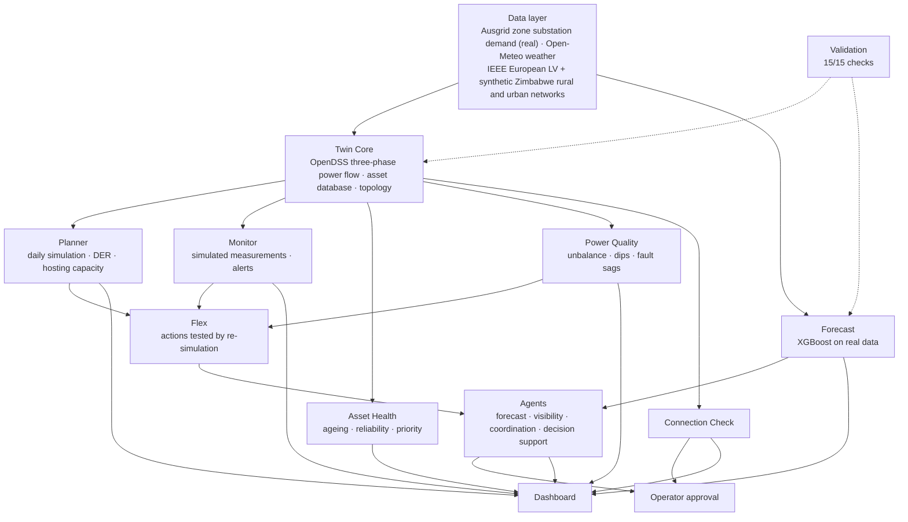

# QGEG LV Digital Twin

**A research prototype** for investigating digital twin methods for low-voltage (LV) distribution networks: three-phase network modelling in OpenDSS, DER integration, day-ahead forecasting on real utility data, flexibility management, and rule-based agents whose every recommendation is verified by re-simulation. It is a research platform, not a deployed utility system.

## Highlights

- **3 network models:** the IEEE European LV Test Feeder (published benchmark) and two synthetic Zimbabwean networks (urban and rural).
- **11 modules,** from the network core to a research dashboard (see Modules below).
- **Real utility data:** 2 years of 15-minute demand for 175 Ausgrid zone substations loaded and quality-checked; day-ahead forecasting at 3 substations.
- **Forecasting:** 47–63% lower error than the last-week baseline in every cross-validation fold; 4.5% MAPE at City North (Sydney CBD).
- **Hosting capacity:** rooftop PV limited by overvoltage at about 10% (rural), 20% (urban) and 30% (European) of homes.
- **Agent coordination (simulated 50% PV + 30% EV stress test):** severity score 273.8 → 1.4 on the rural network; violation-hours 12 → 0.25 on the urban network.
- **Validation:** 15/15 verification and validation checks passed, with documented limitations.

## Key contributions

1. **Verified decision support:** agents propose actions, re-simulate every combination, reject invalid or limit-breaking results, rank by a severity score, and require operator approval.
2. **Weak networks in a developing-country context:** rural and urban Zimbabwean networks with irrigation pumps, grinding mills and load-shedding-driven solar.
3. **Adaptive forecasting on real data:** a forecast agent that detects sustained bias (such as a load transfer) and switches models, staying within about 3% of the best model at each substation.
4. **Connection Check:** approve, approve with conditions, or refuse new PV and EV connections, with the simulated evidence behind each decision.

## Architecture

## Validation summary

The network models are **verified**: an independent hand calculation agrees with OpenDSS to five decimal places, energy balance closes within 0.014% at every step, losses scale with load as physics predicts, topology is intact, and the synthetic networks rebuild byte-for-byte. Forecasts are **validated** on real Ausgrid data with rolling-origin cross-validation. The network models are **not validated against field measurements**, which were not available; this, and nine other limitations, are listed in [docs/validation_report.md](docs/validation_report.md).

## What this is not

Not a deployed or live system, not field-validated, and not based on real ZETDC network data. Field validation, live telemetry, fault detection from measurements and harmonics are future work with a utility partner.

## Status

| Component | Status |
|---|---|
| Repository and environment | Working |
| Feeder models (3 networks, see below) | Working |
| Snapshot power flow | Working |
| Digital twin core: asset database and network topology | Working |
| Time-series (daily) simulation | Working |
| LV monitoring and alerts (simulated measurements) | Working |
| Asset health bands, transformer ageing, reliability (assumed fault rates) | Working |
| DER scenarios and PV hosting capacity (simulated) | Working |
| Power quality: unbalance, neutral current, motor-start dips, fault sags (no harmonics/flicker) | Working |
| Interactive network maps, local coordinates (docs/maps) | Working |
| Flexibility actions tested by re-simulation (rebalancing, managed EV, smart battery, volt-watt, motor starting) | Working |
| Rule-based agents: adaptive forecasting, visibility, coordination by re-simulation, decision reports with operator approval gate | Working |
| Day-ahead net demand forecasting on real Ausgrid zone substation data (XGBoost) | Working |
| Dashboard | Not started |
| Validation: 15/15 checks passed (benchmark, energy balance, scaling, integrity, reproducibility, forecast cross-validation) | Working |

## Networks

| Network | Source | Transformer | Customers | Feeders |
|---|---|---|---|---|
| european_lv | IEEE European LV Test Feeder (published benchmark) | 800 kVA, 11/0.416 kV | 55 | 1 |
| zimbabwe_urban | Synthetic, representative high-density suburb | 315 kVA, 11/0.42 kV | 128 | 4 |
| zimbabwe_rural | Synthetic, representative rural village, farm and business centre | 100 kVA, 11/0.42 kV | 58 | 3 |

The two Zimbabwean networks are synthetic. They are not real ZETDC feeders. Equipment values are approximate typical figures and all load profiles are synthetic. Simulations use 230/400 V, 50 Hz nominal. See the README in each opendss/ folder.

## Setup

    py -3.12 -m venv .venv
    .\.venv\Scripts\Activate.ps1
    pip install -r requirements.txt

## Usage

    python src\build_zim_rural.py             # rebuild the synthetic feeders (optional)
    python src\build_zim_urban.py
    python src\load_feeder.py zimbabwe_rural  # snapshot power flow
    python src\twin_core.py zimbabwe_rural    # asset database and topology

Outputs are written to data/assets/<network>/ and models/<network>/network.graphml.

## Data sources

Raw data is not included in this repository. To reproduce the forecasting results:

- **Ausgrid Distribution Zone Substation Data** (FY2025 and FY26), from the Research data sets page on ausgrid.com.au. 15-minute net demand (MW) for 175 zone substations. Ausgrid copyright; raw SCADA data, not validated by Ausgrid. Place the two .zip files in `data/raw/ausgrid_zone/`, unzip them, then run `python src\ingest_ausgrid_zone.py`.
- **Open-Meteo Historical Weather API** (ERA5-based reanalysis), CC BY 4.0. Downloaded by `python src\fetch_weather.py`.

Then run `python src\forecast_zone.py`.

Data issues found and handled: non-chronological column order in the raw files, dataset-wide gaps on 11 days, held (repeated) values including a network-wide event on 16 Feb 2026, spikes, and a sustained load transfer at Kogarah from 21 Mar 2026.

